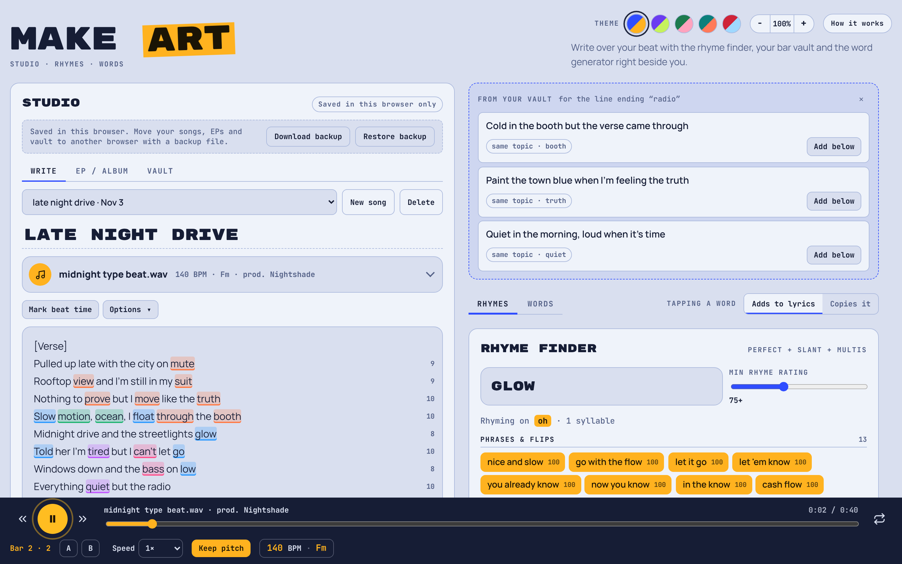
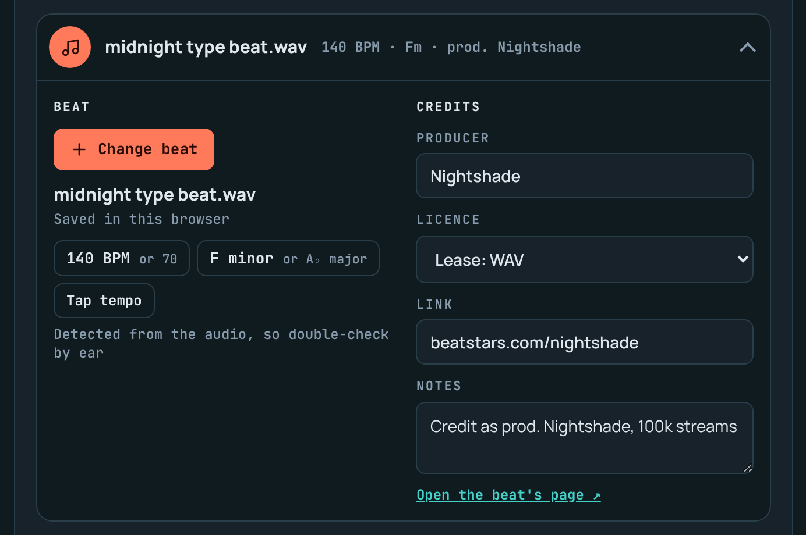
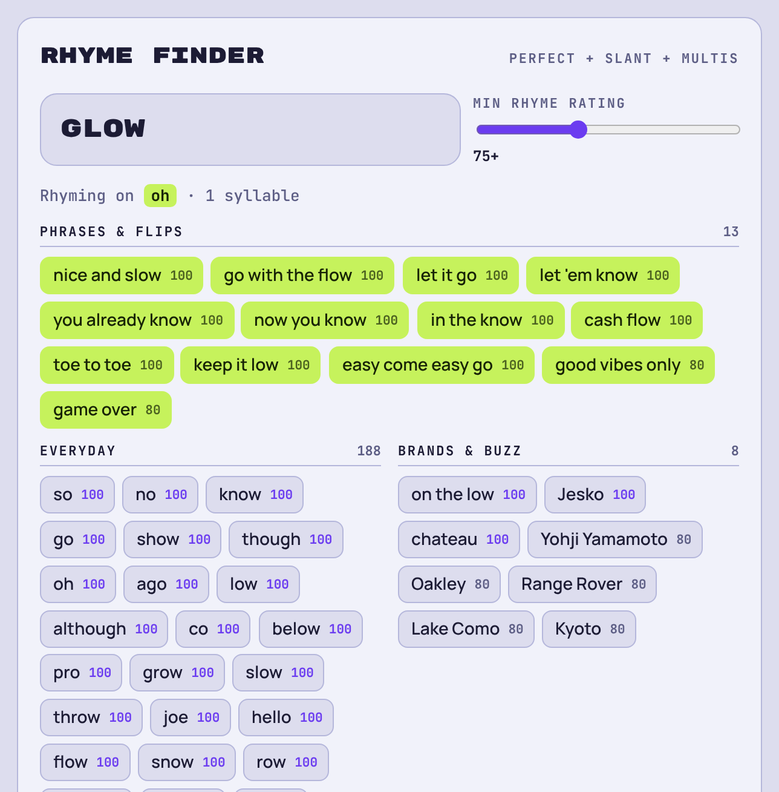
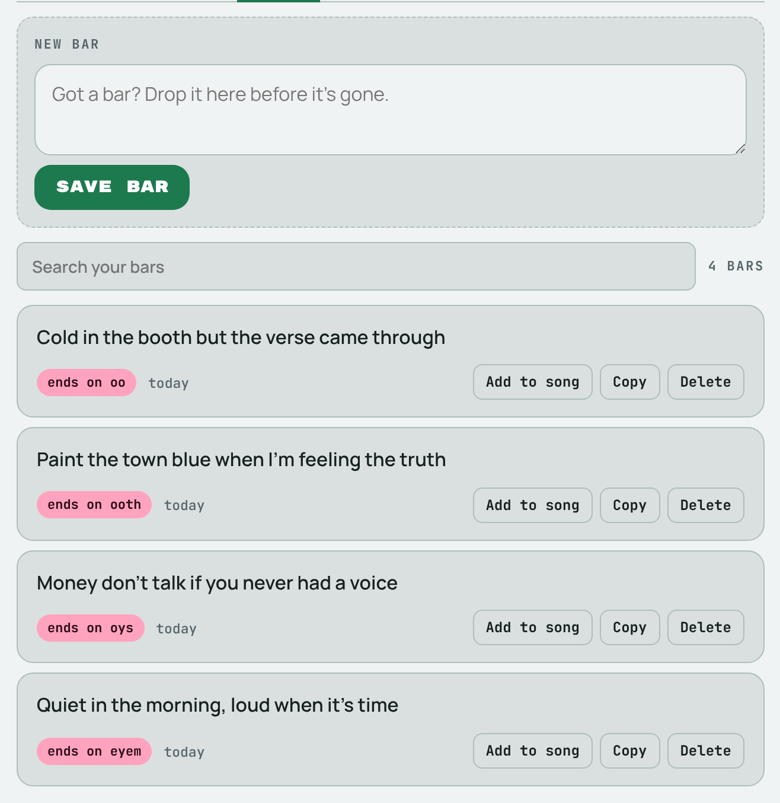
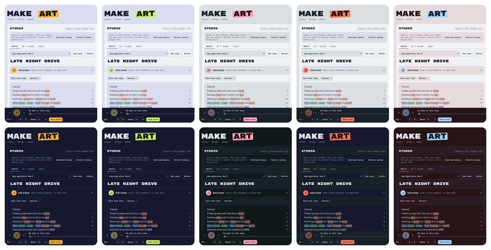
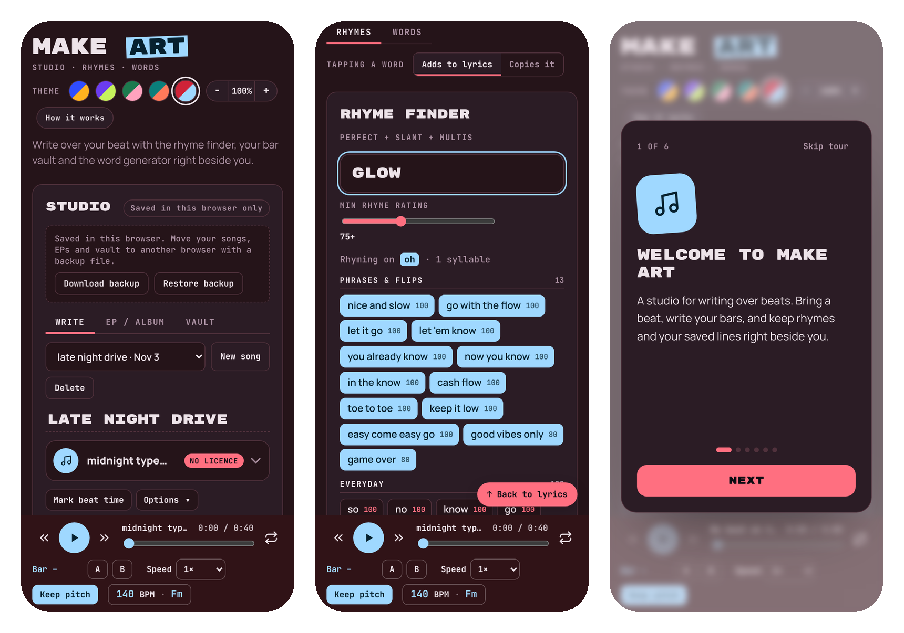

<div align="center">


# Make Art

**Write over your beat with rhymes, bars and BPM right beside you.**

A free lyrics studio that runs in your browser. Drop in a beat, write your verse, and keep the rhyme finder, your saved bars and the beat's tempo and key on the same screen.

[**🎤 Open the app**](https://808alex.github.io/make-art/app/) · [Website](https://808alex.github.io/make-art/) · [How it saves](#-your-stuff-stays-yours)




</div>

## ✨ What it does

### 🎧 Bring a beat, get the numbers
Drag an MP3 or WAV anywhere onto the page. Make Art detects the **BPM and key** straight away, then gives you an A–B loop, a bar counter, and speed from 0.7× to 1.25× with or without keeping the pitch. Beats in browser-only mode stay on your device.



### 🖍️ Rhymes you can see
Words in the same rhyme family light up in the same colour as you write, and every bar shows its syllable count. Words you lean on too much across your songs get a wavy underline, so you catch "drip ×12" before anyone else does.

### 🔎 A rhyme finder that thinks in flows
Perfect rhymes, slant rhymes and multis, each scored 0–100. Type two or three words and it matches the whole flow ("call you" → "ball do"). Results are sorted into Everyday, Brands & buzz, Archive pieces and Rare & distinct. Tap one and it goes straight into your lyrics.



### 💡 A vault for loose bars
Save a line the second it hits you. Search your bars, filter by rhyme sound, and drop one into a song. While you write, the vault suggests saved bars that rhyme with your line or share its topic.



### 💿 EPs, albums and credits
- Group songs into an EP or album, reorder tracks, see the total runtime and copy the tracklist
- Save the producer, link and licence with each beat. Beats that aren't cleared for release get flagged before you drop.
- Mark beat times like `[1:24]` in your lyrics, jump to them, or loop that part
- A word generator for when you're stuck: mostly calm everyday words, with a bit of slang, labels, cars and places mixed in

## 🎨 Five themes, light and dark

Each theme is just two colours: **Classic** (cobalt + marigold), **Grape** (violet + lime), **Moss** (green + pink), **Lagoon** (teal + coral) and **Cherry** (red + sky blue). Light or dark follows your device.



The app moves too: smooth scrolling, click ripples, staggered results, a circular reveal when you switch themes, and a play button and logo that pulse with the beat. There's an in-app zoom (70%–150%), a short skippable tour the first time you open it, and keyboard controls that stay out of your way: `Space` to play/pause and `←` `→` to skip 5 seconds, only when you're not typing.

## 📱 Works on your phone



## 🔒 Your stuff stays yours

There's no account and no server. On the website, everything is saved **in the browser you're using**: songs, EPs and the vault in localStorage, beats in IndexedDB. Nothing is sent anywhere. The app asks the browser to keep that storage, so closing the tab or turning off your computer doesn't lose anything.

To move your work to another browser or device, use **Download backup** and **Restore backup** in the studio (backups include songs, EPs and the vault, not beat files). Clearing your browser's site data deletes everything, so download a backup now and then.

---

## 🛠️ For developers

### Run it locally

```
python3 -m http.server 8000
```

Then open http://localhost:8000. There's no build step: the scripts are plain browser scripts that load in order and share globals.

### Project layout

```
index.html           page markup (no <html>/<head>; the artifact host or build script adds that)
css/styles.css       layout and components; colour themes and font tokens at the top
css/look.css         theme picker, zoom, tour and all motion
js/engine.js         rhyme engine: pronunciations, scoring, phrase builder
js/sayings.js        sayings used by the phrase column
js/generator.js      word pools, generator, stash, shared helpers (esc, toast, copy)
js/finder.js         rhyme finder UI
js/studio.js         songs, saving and sync, beat loading, player basics, Space / arrow keys
js/extras.js         rhyme colours, syllables, A–B loop, speed, BPM/key, EP / album
js/vault.js          bar vault
js/credits.js        beat credits (producer, link, licence)
js/insights.js       vault suggestions while writing, overused words
js/backup.js         download / restore a backup file (browser-only mode)
js/tour.js           first-run tour
js/look.js           theme switch, zoom, click ripples, scroll reveal, smooth scroll, beat pulse
data/rhymes.txt      ~42k words with encoded pronunciations (built by tools/)
site/                landing page for GitHub Pages (plus favicon and screenshot)
docs/img/            screenshots used in this README
tools/build_site.py  builds the Pages site into _site/
tools/publish_pages.sh  builds the site and pushes it to the gh-pages branch
tools/               also holds the scripts that build data/rhymes.txt
```

### The website (GitHub Pages)

`tools/build_site.py` builds `_site/`: the landing page from `site/` at the root and the app at `/app/` (it wraps `index.html` in a full HTML document and copies `css/`, `js/` and `data/`). `tools/publish_pages.sh` builds it and pushes the result to the `gh-pages` branch, which GitHub Pages serves.

To turn it on once: repo **Settings → Pages → Build and deployment → Source: Deploy from a branch → Branch: `gh-pages` / `(root)` → Save**. After that, run `tools/publish_pages.sh` whenever you want the website updated.

### Saving and sync

The same code saves in one of two ways:

- **On the website (or opened locally):** browser-only, as described above. `navigator.storage.persist()` is requested so the browser doesn't clear it under storage pressure.
- **As a Claude artifact:** songs, EPs, the vault and beats sync through the artifact's built-in storage, which is private to each signed-in user:
  - Songs: one document per song in the `data/users/<id>` collection
  - EPs / albums: one document with id `tapes` in the same collection
  - Bar vault: one document with id `vault` in the same collection
  - Beats: uploaded as MP4/WebM audio (MP3/WAV are converted in the browser first)

This lives in `js/studio.js` (`initCloud`, `saveSong`, `applySnapshot`, `syncBeat`) and `saveTapes` in `js/extras.js`. To add real accounts on the website, replace that layer with your own backend (for example Supabase for auth, database and file storage). The rest of the app doesn't depend on it.

### How the audio analysis works

- **BPM:** onset strength from spectral flux, then a comb filter over likely tempos; half and double time are shown as the alternative
- **Key:** a chroma profile weighted towards the bass, matched against Krumhansl major and minor profiles; the relative key is shown as the alternative
- Both run in the browser on the decoded audio, so nothing is uploaded

### Rebuilding the rhyme dictionary

```
pip install cmudict wordfreq
python3 tools/build_dict.py   # writes rhymes.txt
python3 tools/enc.py          # compresses it to rhymes.dat, then copy to data/rhymes.txt
```

## 📄 Licence

The code is MIT licensed (see `LICENSE`): use it, change it and share it, as long as you keep the copyright notice crediting **Alexander Zudins (808alex)**.

The word list in `data/rhymes.txt` is the one exception: it's shared under CC BY-SA 4.0 because its word ranking comes from wordfreq (see `data/NOTICE.md`).

## 🙏 Credits

- Pronunciations: CMU Pronouncing Dictionary (BSD-style licence)
- Word ranking: word frequencies from [wordfreq](https://github.com/rspeer/wordfreq) by Robyn Speer (data CC BY-SA 4.0)
- MP4 audio muxing: `mp4-muxer` (MIT), loaded from jsDelivr
- Smooth scrolling: `lenis` (MIT), loaded from jsDelivr
- Fonts: Rubik Mono One, Manrope and JetBrains Mono, all from Google Fonts (OFL)

<div align="center">

Made by [808alex](https://github.com/808alex) 🎶

</div>
